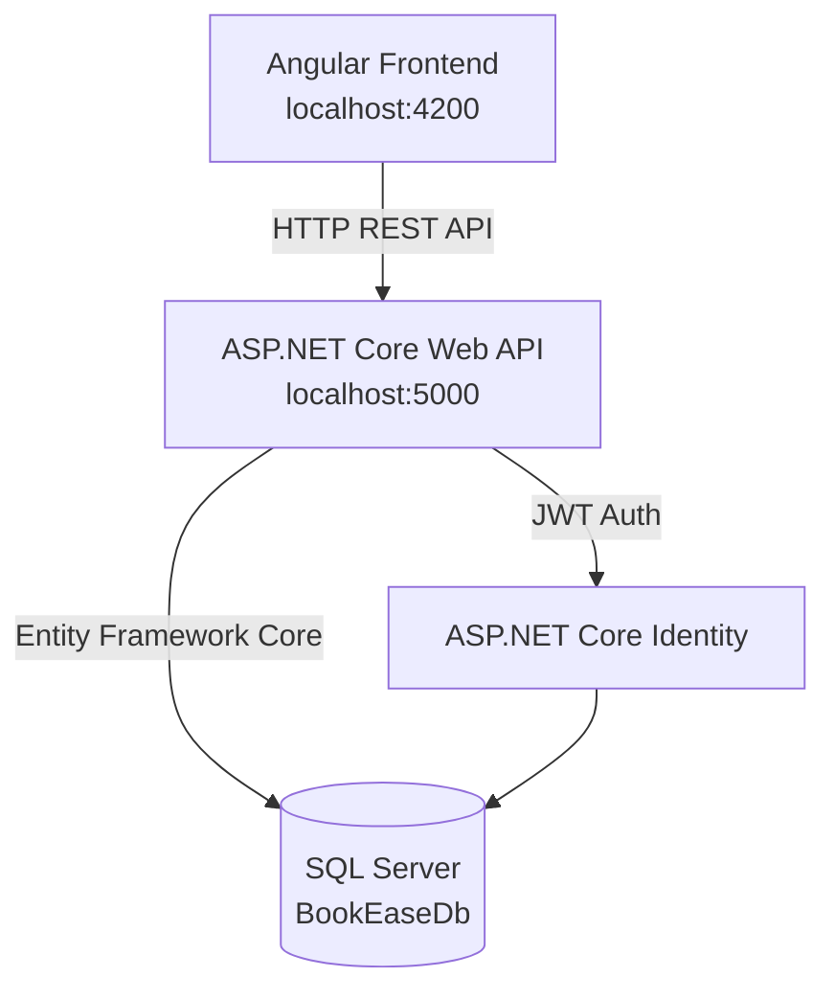
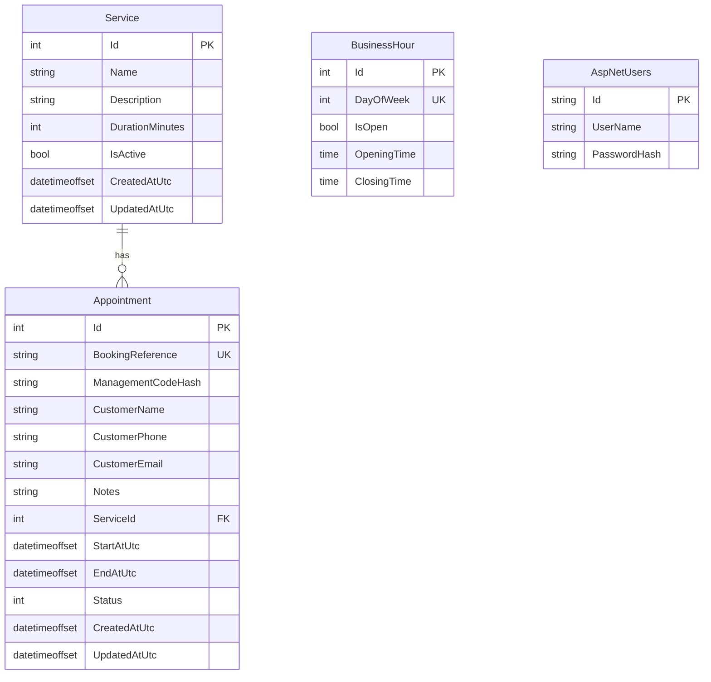

# BookEase — Appointment Booking System

A complete full-stack appointment booking system built with **Angular**, **ASP.NET Core**, and **SQL Server**.

Customers can browse services, view available time slots, book appointments without registration, and manage their bookings. An administrator can sign in to manage services, business hours, appointments, and booking statuses.

## Project Purpose

BookEase is a portfolio project demonstrating practical software engineering skills:

- Angular + TypeScript frontend with RTL Arabic UI
- ASP.NET Core Web API backend
- SQL Server with Entity Framework Core
- REST API integration
- DateTime and time zone handling
- Business logic: availability calculation, conflict prevention, concurrency control
- Secure booking management without customer accounts
- JWT authentication for administrators

## Main Features

### Customer Features
- Browse active services with descriptions and durations
- Select appointment date and view dynamically calculated available time slots
- Multi-step guided booking flow (no registration required)
- Receive a unique booking reference and secure management code
- Retrieve, reschedule, or cancel bookings using credentials

### Administrator Features
- Secure JWT-based login (no public registration)
- Dashboard with real-time statistics and today's schedule
- Appointment management with search, filters, pagination, and status updates
- Service management (create, edit, activate/deactivate)
- Business hours configuration per day of the week

## Technology Stack

| Layer | Technology |
|-------|-----------|
| Frontend | Angular 19, TypeScript, SCSS, Standalone Components |
| Backend | ASP.NET Core 6.0, C# |
| Database | SQL Server 2022, Entity Framework Core 6.0 |
| Auth | ASP.NET Core Identity, JWT Bearer |
| Rate Limiting | AspNetCoreRateLimit |
| API Docs | Swagger / OpenAPI |

## Architecture Overview



## Database Design



### Key Database Features
- Unique index on `BookingReference`
- Composite index on `(StartAtUtc, EndAtUtc, Status)` for availability queries
- Foreign key from Appointment to Service with `ON DELETE RESTRICT`
- Unique constraint on `BusinessHour.DayOfWeek`
- Management codes stored as SHA-256 hashes (never plaintext)

## Appointment Business Rules

### Availability Calculation
- Slots generated dynamically based on business hours, service duration, and configurable interval (default: 30 min)
- Only slots where the full service duration fits within business hours are offered
- Past time slots are excluded
- Existing Pending/Confirmed appointments block their time ranges
- Cancelled appointments do not block availability

### Conflict Prevention
Overlap check: `ExistingStart < RequestedEnd AND ExistingEnd > RequestedStart`

Adjacent appointments are allowed (e.g., 10:00–11:00 and 11:00–12:00).

### Concurrency Control
Uses SQL Server `sp_getapplock` within a database transaction:
1. Begin transaction
2. Acquire exclusive application lock (`BookingLock`)
3. Re-check for conflicts against current database state
4. Insert appointment only if no conflict
5. Commit or rollback

This applies to both new bookings and rescheduling.

### Status Transitions
| From | Allowed To |
|------|-----------|
| Pending | Confirmed, Cancelled |
| Confirmed | Completed, Cancelled |
| Cancelled | (none) |
| Completed | (none) |

## DateTime and Time Zone Handling

- All appointment timestamps stored as `DateTimeOffset` in UTC
- Business time zone configured in `appsettings.json` (`BusinessSettings:TimeZoneId`)
- Default: `Arab Standard Time` (UTC+3, Asia/Riyadh)
- Availability API converts business hours to UTC for slot generation
- API returns both local time strings (`startTime`/`endTime` as `HH:mm`) and UTC timestamps (`startAtUtc`/`endAtUtc`)
- Frontend uses UTC timestamps for booking requests
- Daylight saving transitions handled by `TimeZoneInfo` conversions

## Authentication Approach

- Administrator uses ASP.NET Core Identity with password hashing (PBKDF2)
- JWT tokens issued on login (8-hour expiration)
- All `/api/admin/*` endpoints require `[Authorize]` (except login)
- No public admin registration
- Initial admin account created by database seeder

Customer booking management uses:
- **Booking Reference**: Public identifier (e.g., `BK-LUTLSPF3`)
- **Management Code**: 16-character cryptographically random secret, stored as SHA-256 hash
- Both required to access, reschedule, or cancel a booking

## API Endpoint Summary

### Public
| Method | Endpoint | Description |
|--------|----------|-------------|
| GET | `/api/services` | List active services |
| GET | `/api/services/{id}` | Get service details |
| GET | `/api/availability?serviceId=&date=` | Get available time slots |
| POST | `/api/appointments` | Create booking |
| POST | `/api/appointments/manage/verify` | Verify booking credentials |
| PUT | `/api/appointments/manage/{ref}/reschedule` | Reschedule appointment |
| POST | `/api/appointments/manage/{ref}/cancel` | Cancel appointment |

### Admin (requires JWT)
| Method | Endpoint | Description |
|--------|----------|-------------|
| POST | `/api/admin/auth/login` | Admin login |
| GET | `/api/admin/auth/me` | Current admin user |
| GET | `/api/admin/dashboard/summary` | Dashboard statistics |
| GET | `/api/admin/appointments` | List appointments (search, filter, paginate) |
| GET | `/api/admin/appointments/{id}` | Appointment details |
| PUT | `/api/admin/appointments/{id}/status` | Update appointment status |
| GET | `/api/admin/services` | List all services |
| POST | `/api/admin/services` | Create service |
| PUT | `/api/admin/services/{id}` | Update service |
| PATCH | `/api/admin/services/{id}/status` | Activate/deactivate service |
| GET | `/api/admin/business-hours` | Get business hours |
| PUT | `/api/admin/business-hours` | Update business hours |

## Project Structure

```
BookEase/
├── backend/
│   └── BookEase.Api/
│       ├── Configuration/     # Settings classes
│       ├── Controllers/       # API controllers
│       ├── Data/              # DbContext, seeder
│       ├── DTOs/              # Request/response models
│       ├── Entities/          # EF Core entities
│       ├── Migrations/        # EF Core migrations
│       ├── Services/          # Business logic
│       ├── Program.cs
│       └── appsettings.json
├── frontend/
│   └── bookease-client/
│       └── src/app/
│           ├── core/          # Models, services, guards, interceptors
│           ├── features/
│           │   ├── public/    # Home, booking, manage-booking
│           │   └── admin/     # Login, dashboard, appointments, services, business-hours
│           └── layout/        # Public and admin layouts
├── .gitignore
└── README.md
```

## Prerequisites

- .NET 6.0 SDK
- Node.js 18+ and npm
- Angular CLI (`npm install -g @angular/cli`)
- SQL Server (Developer, Express, or LocalDB)

## Setup and Running

### 1. SQL Server Setup

Ensure SQL Server is running. The default connection string uses Windows Authentication:

```
Server=localhost;Database=BookEaseDb;Trusted_Connection=True;TrustServerCertificate=True;
```

To use a different server, update `ConnectionStrings:DefaultConnection` in `backend/BookEase.Api/appsettings.json`.

### 2. Database Migration

```bash
cd backend/BookEase.Api
dotnet ef database update
```

This creates the `BookEaseDb` database and applies all migrations.

### 3. Backend Startup

```bash
cd backend/BookEase.Api
dotnet run --urls "http://localhost:5000"
```

On first run, the database seeder creates:
- 5 sample services (4 active, 1 inactive)
- Business hours (Sun–Thu 09:00–17:00, Fri closed, Sat 10:00–14:00)
- Admin account: `admin` / `Admin@123456`

Swagger UI: http://localhost:5000/swagger

### 4. Frontend Startup

```bash
cd frontend/bookease-client
npm install
npx ng serve
```

Open http://localhost:4200

### 5. Administrator Initial Setup

1. Navigate to http://localhost:4200/admin/login
2. Sign in with username `admin` and password `Admin@123456`
3. Change admin credentials via the database or Identity API for production use

## Testing

### Backend Tests Executed

| # | Test | Result |
|---|------|--------|
| 1 | Get active services | PASS |
| 2 | Get single service | PASS |
| 3 | Get availability (16 slots for 30-min service) | PASS |
| 4 | Create booking | PASS |
| 5 | Duplicate booking rejected | PASS |
| 6 | Verify booking with correct credentials | PASS |
| 7 | Verify with wrong management code rejected | PASS |
| 8 | Reschedule appointment | PASS |
| 9 | Booked slot unavailable after booking | PASS |
| 10 | Cancel appointment | PASS |
| 11 | Slot released after cancellation | PASS |
| 12 | Past date booking rejected | PASS |
| 13 | Admin login | PASS |
| 14 | Admin /me authenticated | PASS |
| 15 | Dashboard summary with real data | PASS |
| 16 | Admin get appointments with pagination | PASS |
| 17 | Admin get all services (including inactive) | PASS |
| 18 | Business hours (7 days configured) | PASS |
| 19 | Unauthorized access denied | PASS |
| 20 | Admin confirm appointment | PASS |
| 21 | Overlapping booking rejected | PASS |
| 22 | Admin create service | PASS |
| 23 | Admin deactivate service | PASS |
| 24 | Inactive service booking rejected | PASS |
| 25 | Business hours update | PASS |

### Frontend Build
- Angular build: **0 errors**, 0 warnings (1 style budget advisory)

## Project Limitations

- No email or SMS notifications
- No online payments
- Single business / single calendar (no multi-staff)
- No customer registration or login
- Admin password change requires direct database or API access
- Rate limiting uses in-memory store (resets on restart)
- No HTTPS configured for development (use a reverse proxy for production)
- No automated unit tests (integration tests performed via API)
- Concurrency test with true simultaneous requests requires a load testing tool

## Steps Before Publishing to GitHub

1. Change the JWT secret key in `appsettings.json`
2. Change the default admin password
3. Consider moving secrets to User Secrets or environment variables
4. Verify `.gitignore` excludes all build artifacts and secrets
5. Run `git init && git add . && git commit -m "Initial commit"`
